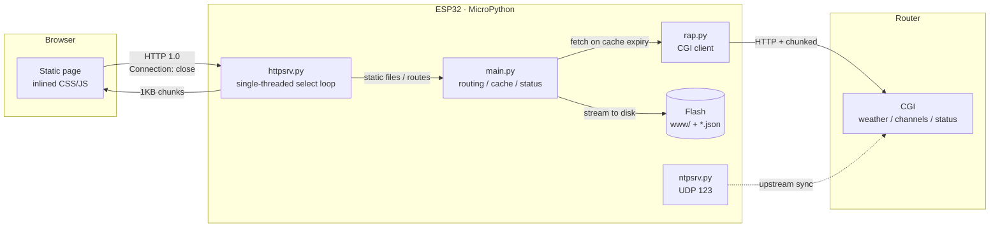

# ESP32 Terminal Server

A headless terminal server built on ESP32 + MicroPython. It runs a single-threaded HTTP
server that serves pages and APIs to the local network; data comes from CGI endpoints on
the router.

**English** · [简体中文](README.md)


Two hardware targets are supported, with the code split per board:

| Directory | Board | CPU | Flash / RAM | Differences |
|---|---|---|---|---|
| `esp32/` | ESP32-D0WD-V3 | 160 MHz | 4MB / 520KB | Baseline, single-color LED on GPIO2 |
| `esp32-s3/` | ESP32-S3 N16R8 | 240 MHz | 16MB / 8MB PSRAM | Python heap in PSRAM, native USB serial, WS2812 LED, idle frequency scaling |

Pages and APIs are essentially identical between the two builds; differences are limited to
LED driver, WiFi power saving, memory layout and frequency management. The news and quake
pages, together with `/api/news`, `/api/quake`, `/api/led`, `/api/oil` and `/api/almanac`,
exist only in the S3 build.

---

## Features

| Page | Path | Content |
|---|---|---|
| Home | `/` | Device status, today's lunar date, current weather, entry points |
| Weather | `/weather.html` | Current conditions, hourly, 7-day forecast, air quality, life indices |
| Market | `/market.html` | Three major indices, FX rates, watchlist (stored on device), Anhui fuel prices (cached daily; fuel prices S3 only) |
| Radio | `/radio.html` | 67 stations in 9 categories, search and collapsing |
| News | `/news.html` | Single-column cards, time and importance on the title row, full body text, tags below the card, importance and topic filters, bold `【】` titles, tap a stock tag to add/remove it from the watchlist, hourly catch-up fetch (S3 only) |
| Quake | `/quake.html` | Domestic / global / USGS sources, 7-day bar chart with M3 / M4 / M5 / M6 buckets, cards with magnitude block, location, depth and coordinates, magnitude filter and coloring (S3 only) |
| Device | `/info.html` | Firmware, board, CPU, chip temperature, internal RAM blocks, MAC, heap, flash, sleep history and timeline |
| NTP | `/ntp.html` | Almanac (lunar date, sexagenary cycle, dos and don'ts, solar terms, cached daily), on-board NTP server status, upstream sync, time zone |
| IPTV | `/iptv.html` | Channel library browsing and in-browser playback |
| Upgrade | `/ota.html` | Upload an upgrade package, show version and free space, reboot to apply (S3 only) |

Pages share `web/theme.css` and `web/ui.js` and follow the system light/dark theme, with a
manual toggle in the top bar (the choice is kept in the browser). After the build each page is
a single file with CSS/JS inlined plus a gzip-compressed variant. The top bar shows the device
IP, a status dot and the LED heartbeat toggle (S3 only). The news and quake pages show a
back-to-top button in the bottom-right corner once you scroll past one screen.

---

## Hardware and dependencies

| Item | ESP32 build (`esp32/`) | S3 build (`esp32-s3/`) |
|---|---|---|
| MCU | ESP32-D0WD-V3, 4MB flash | ESP32-S3 N16R8, 16MB flash + 8MB Octal PSRAM |
| Firmware | MicroPython v1.26.1 `ESP32_GENERIC` | MicroPython v1.29.0 `ESP32_GENERIC_S3-SPIRAM_OCT` |
| Flash offset | `0x1000` | `0x0` |
| Serial port | CH9102 / CP2102 (USB-to-UART) | Native USB-Serial/JTAG |
| Indicator | Single-color LED on GPIO2 | GPIO48 WS2812, low-brightness heartbeat, toggle in the top bar |

No SD card or peripherals required. On the S3 build the Python heap lives in PSRAM while
internal SRAM is left to WiFi and lwIP. The data source is a router running the CGI
endpoints, see [docs/CONFIG.en.md](docs/CONFIG.en.md).

---

## Architecture



Boot sequence, request lifecycle and the build pipeline are described in
[docs/ARCHITECTURE.en.md](docs/ARCHITECTURE.en.md).

---

## Quick start

[Releases](https://github.com/isunding/ESP32Server/releases) provide `source.zip` (full
source) and `deploy.zip` (board files: runtime modules, `www/` and the config template).

### 1. Flash the firmware

```bash
# Enter download mode: hold BOOT, tap EN/RST, release BOOT

# ESP32 / ESP32-D0WD-V3
esptool.py --chip esp32  --port COM3 erase_flash
esptool.py --chip esp32  --port COM3 --baud 460800 write_flash -z 0x1000 \
  ESP32_GENERIC-20250911-v1.26.1.bin

# ESP32-S3 N16R8
esptool.py --chip esp32s3 --port COM3 erase_flash
esptool.py --chip esp32s3 --port COM3 --baud 460800 write_flash -z 0x0 \
  ESP32_GENERIC_S3-SPIRAM_OCT-20260824-v1.29.0.bin
```

The ESP32 build must preserve the RF calibration data at `0xF000`, see
[docs/DEPLOY.en.md](docs/DEPLOY.en.md).

### 2. Configure

```bash
cp esp32/config.example.json esp32/config.json          # or esp32-s3/config.example.json
# edit wifi.ssid / wifi.password / router.host
```

`config.json` is excluded by `.gitignore`. Field reference: [docs/CONFIG.en.md](docs/CONFIG.en.md).

### 3. Deploy

```bash
pip install mpremote
export ESP32_PORT=COM3            # serial port
export ESP32_HOST=192.168.1.50    # device IP

python esp32-s3/scripts/build.py                       # build pages
python esp32-s3/scripts/flash.py esp32-s3/main.py esp32-s3/www/index.html ...
```

`flash.py` uploads the files, resets the device, captures the boot log and runs a
`/api/health` self-check. For larger file sets use `scripts/up_batch.py` to upload in
batches. `scripts/mpy.py` precompiles core modules to `.mpy`.

Both board directories use the same scripts. Full steps: [docs/DEPLOY.en.md](docs/DEPLOY.en.md).

---

## API

| Method | Path | Description |
|---|---|---|
| GET | `/api/health` | IP, RSSI, uptime, free heap, router reachability, LED state (`led_on` / `led_hw`) |
| GET | `/api/home` | Health, service status, today's calendar data |
| GET | `/api/info` | Firmware, board, CPU frequency, chip temperature, reset reason, internal RAM blocks, MAC, heap, flash, file list |
| GET | `/api/weather` | Aggregated weather (current / hourly / 7-day / air / alerts / indices); `?force=1` clears both cache layers and refetches |
| GET | `/api/weatherhist` | Past 7 days (first call returns `pending`; the main loop fetches it in the background) |
| GET | `/api/channels` | Channel library |
| GET | `/api/services` | rtp2httpd / udpxy status |
| GET | `/api/calendar` | Lunar date, solar terms, festivals |
| GET | `/api/quote` | Indices and FX rates, 10-minute TTL, `?force=1` forces a refresh |
| GET | `/api/oil` | Anhui fuel prices (92 / 95 / 98 / 0 diesel and others), 24-hour TTL, `?force=1` (S3 only) |
| GET | `/api/almanac` | Today's almanac (lunar date, sexagenary cycle, dos and don'ts, zodiac), 24-hour TTL (S3 only) |
| GET | `/api/watch` | Watchlist quotes (`?a=codes` returns codes only, no quotes; entries without quotes return a placeholder row) |
| POST | `/api/watch` | `{"op":"add"/"del","code":"sh600519"}`, up to 20 symbols |
| GET | `/api/ntp` | NTP status, upstream, time zone |
| POST | `/api/ntp` | `sync` / `srv` / `upstream` / `interval` / `tz` |
| GET | `/api/config` | Read configuration (passwords masked) |
| POST | `/api/config` | Save configuration and restart |
| POST | `/api/led` | `{"on":0/1}`, LED heartbeat toggle, writes `led.on` and takes effect immediately (S3 only) |
| GET | `/api/news` | News feed (last 7 days, local CSV); `?limit=<n>` and `?before=<ctime>` page backwards, `?force=1` triggers an upstream refresh; hourly catch-up fetch pages back to the last collected item (S3 only) |
| GET | `/api/ota` | Upgrade status: version (`ver`), pending-reboot flag (`pending`), last 5 records (`hist`), last write, file count, free space (S3 only) |
| PUT | `/api/ota` | `?path=<relative path>&crc=<crc32>` uploads a single file; written to `.new`, replaced only when length and CRC match (S3 only) |
| PUT | `/api/ota/pack` | Upload an upgrade package (`MRP2`), unpacked while receiving, verified per entry (S3 only) |
| POST | `/api/ota` | `?a=done&ver=<version>` records the version and reboots; `?a=reboot` reboots only (S3 only) |
| GET | `/api/quake` | Quake list (last 7 days, local CSV); `?a=global` for global events, `?a=usgs` for USGS M2.5+ in the last 24 hours, `?force=1` to refresh; the response carries `stat` (daily counts for 7 days plus M3 / M4 / M5 / M6 totals) (S3 only) |
| GET | `/api/sleep` | Sleep intervals (last 7 days, from `sleep-YYYYMMDD.csv`); `?limit=<n>` and `?before=<end timestamp>` page backwards, and `sum` reports the 7-day count and total seconds (S3 only) |

---

## Layout

```
.
├── esp32/                 ESP32-D0WD-V3 build (baseline)
│   ├── boot.py            On boot: join WiFi / start config AP
│   ├── main.py            Routing, cache, status, API
│   ├── httpsrv.py         Single-threaded non-blocking HTTP server
│   ├── rap.py             Router CGI client
│   ├── netmgr.py          WiFi management
│   ├── ntpsrv.py          On-board NTP server (UDP 123)
│   ├── ntpsync.py         NTP client
│   ├── cncal.py           Lunar date / solar terms / festivals
│   ├── config.example.json Config template
│   ├── web/               Page sources
│   ├── www/               Build output (deploy this directory)
│   └── scripts/           Build, upload, flash, precompile
├── esp32-s3/              ESP32-S3 N16R8 build (same layout, plus news and quake pages)
├── mirouter/              Router-side components (data CGI, IPTV, page injection, binaries)
│   ├── cgi/               Shell CGI, deployed to /data/iptv/www/cgi-bin/
│   ├── iptv/              Start/stop scripts, playlist builder, console pages
│   ├── inject/            Entry-point injection for the stock admin page
│   ├── bin/               udpxy, rtp2httpd
│   └── tools/             Deploy script
└── docs/
    ├── ARCHITECTURE.md  ARCHITECTURE.en.md
    ├── CONFIG.md        CONFIG.en.md
    └── DEPLOY.md        DEPLOY.en.md
```

`www/` is generated from `web/` by `scripts/build.py`; edit pages under `web/`.
Router-side components and their deployment rules: [mirouter/README.md](mirouter/README.md).
Files under `mirouter/` are written in Chinese.

---

## Design constraints

| Constraint | Value | Rationale |
|---|---|---|
| GC per request | `gc.collect()` | Prevents temporary objects from accumulating until the heap runs out |
| Listen backlog | 3 | TCP PCBs are allocated during the handshake; the pool is about 10 |
| Connection close | Server waits for the client to close | MicroPython has no `SO_LINGER`; an active close leaves the PCB in TIME_WAIT for 60 seconds |
| select timeout | 30ms | A zero timeout starves the lwIP task |
| Single allocation cap | 8KB | GC does not compact memory, so large blocks fail |
| Persisting files | Write `.tmp`, then rename | Avoids readers seeing a partial file |
| Idle frequency floor | 80 MHz | Lower bound for the WiFi APB and Octal PSRAM timing |
| Full-speed baseline | Config value `power.max_mhz` | `esp_pm` clock configuration does not survive a soft reset |
| LED heartbeat | Judged from main-loop ticks, no sleep | Avoids waking the CPU so idle frequency scaling is unaffected |

---

## Known limitations

- Single-threaded: a slow request blocks the ones behind it. Network fetches are mostly
  request-driven and only refilled in the main loop after the cache expires; news also has
  an hourly catch-up fetch (S3 only)
- The WiFi password is stored in plain text on flash
- HTTPS is not supported
- Radio stream URLs are provided by third parties
- IPTV audio and video are pulled directly by the browser and do not pass through the ESP32
- `.mpy` files are bound to the interpreter version (currently `.mpy v6.3`); recompile after
  a firmware upgrade
- OTA covers application files (`.py` and `www/`) only, not the firmware image; the upgrade
  endpoints have no authentication and are meant for a local network

---

## Scripts

Day-to-day upgrade steps (exe, package, browser upload) are documented in
[memory.md](memory.md) (Chinese).

| Script | Purpose |
|---|---|
| `scripts/build.py` | Page build: inline CSS/JS, emit gzip (single page: `build.py weather`) |
| `scripts/up_batch.py` | Upload to the device in batches of 4 files |
| `scripts/flash.py` | Upload, reset the device, capture the boot log, run the `/api/health` self-check |
| `scripts/mpy.py` | Precompile modules to `.mpy` (`--revert` restores `.py`) |
| `scripts/ota.py` | Over-the-air update: push `.py` and `www/` over HTTP, or build a package with `--pack` (S3 only) |
| `scripts/pack_ota.py` | Build a package into `ota/`; run automatically by `.githooks/post-commit` (S3 only) |
| `scripts/ota_menu.py` | Menu-driven updater; `ota/OTA升级.exe` is built from it for double-click use (S3 only) |
| `scripts/gen_calendar_data.py` | Rebuild the annual lunar data table |

Each board directory carries its own copy with identical usage (`ota.py` ships with the S3
version only). Serial port and device
address come from environment variables:

```bash
export ESP32_PORT=COM3
export ESP32_HOST=192.168.1.50
```

---

## License

MIT
