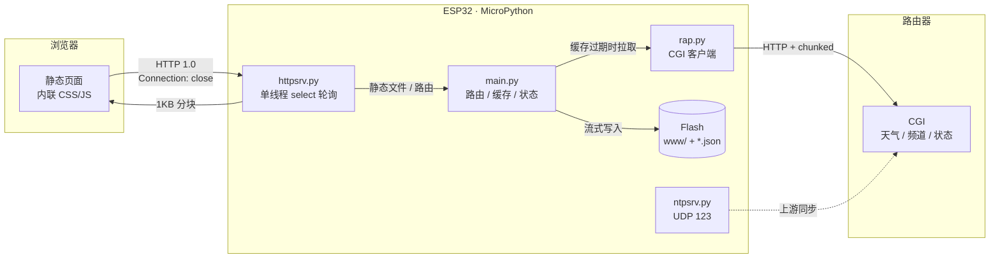

# ESP32 Terminal Server

基于 ESP32 + MicroPython 的无头终端服务器。运行单线程 HTTP 服务，向局域网提供页面与 API，
数据来自路由器上的 CGI 接口。


支持两种硬件，代码按板级目录组织：

| 目录 | 板型 | CPU | Flash / RAM | 差异 |
|---|---|---|---|---|
| `esp32/` | ESP32-D0WD-V3 | 160 MHz | 4MB / 520KB | 基线版本，GPIO2 单色指示灯 |
| `esp32-s3/` | ESP32-S3 N16R8 | 240 MHz | 16MB / 8MB PSRAM | Python 堆在 PSRAM、原生 USB 串口、WS2812 指示灯、空闲降频 |

两版页面、路由与 API 一致，差异限于 LED 驱动、WiFi 省电、内存布局与频率管理。

---

## 功能

| 页面 | 路径 | 内容 |
|---|---|---|
| 首页 | `/` | 设备状态、今日农历、天气实况、功能入口 |
| 天气 | `/weather.html` | 实况、24 小时、7 天预报、空气质量、生活指数 |
| 行情 | `/market.html` | 三大指数、汇率、自选股（存于板上） |
| 电台 | `/radio.html` | 67 个电台 / 9 个分类，支持搜索与折叠 |
| 新闻 | `/news.html` | 单列卡片、时间与重要度置于标题行、正文完整显示、标签置于卡片下方、重要度与主题筛选、`【】` 标题加粗、股票标签点选加入 / 移出自选（仅 S3） |
| 地震 | `/quake.html` | 单列卡片、国内 / 全球切换、近 7 天列表、按震级筛选与配色、经纬度标注 N/S/E/W（仅 S3） |
| 本机 | `/info.html` | 固件、板型、CPU、芯片温度、内部 RAM 分块、MAC、堆、Flash、休眠记录与时间轴 |
| NTP | `/ntp.html` | 板载 NTP 服务端状态、上游同步、时区设置、农历 |
| IPTV | `/iptv.html` | 频道库浏览与网页播放 |

页面共用 `web/theme.css`，支持系统深浅色；构建后为单文件形式，CSS/JS 内联并生成 gzip 预压缩版本。

---

## 硬件与依赖

| 项 | ESP32 版（`esp32/`） | S3 版（`esp32-s3/`） |
|---|---|---|
| 主控 | ESP32-D0WD-V3，4MB flash | ESP32-S3 N16R8，16MB flash + 8MB Octal PSRAM |
| 固件 | MicroPython v1.26.1 `ESP32_GENERIC` | MicroPython v1.29.0 `ESP32_GENERIC_S3-SPIRAM_OCT` |
| 烧写偏移 | `0x1000` | `0x0` |
| 串口 | CH9102 / CP2102（USB 转串口） | 原生 USB-Serial/JTAG |
| 指示灯 | GPIO2 单色 | GPIO48 WS2812（可彻底关闭） |

无需 SD 卡或外设。S3 版 Python 堆位于 PSRAM，内部 SRAM 供 WiFi 与 lwIP 使用。
数据源为运行 CGI 的路由器，见 [docs/CONFIG.md](docs/CONFIG.md)。

---

## 架构



启动流程、请求生命周期、构建流水线见 [docs/ARCHITECTURE.md](docs/ARCHITECTURE.md)。

---

## 快速开始

[Releases](https://github.com/isunding/ESP32Server/releases) 提供 `source.zip`（完整源码）与
`deploy.zip`（板端部署文件：运行模块、`www/` 与配置模板）。

### 1. 烧写固件

```bash
# 进下载模式：按住 BOOT → 点一下 EN/RST → 松开 BOOT

# ESP32 / ESP32-D0WD-V3
esptool.py --chip esp32  --port COM3 erase_flash
esptool.py --chip esp32  --port COM3 --baud 460800 write_flash -z 0x1000 \
  ESP32_GENERIC-20250911-v1.26.1.bin

# ESP32-S3 N16R8
esptool.py --chip esp32s3 --port COM3 erase_flash
esptool.py --chip esp32s3 --port COM3 --baud 460800 write_flash -z 0x0 \
  ESP32_GENERIC_S3-SPIRAM_OCT-20260824-v1.29.0.bin
```

ESP32 版须保留 `0xF000` 处的射频校准数据，见 [docs/DEPLOY.md](docs/DEPLOY.md)。

### 2. 配置

```bash
cp esp32/config.example.json esp32/config.json          # 或 esp32-s3/config.example.json
# 编辑 wifi.ssid / wifi.password / router.host
```

`config.json` 已被 `.gitignore` 排除。字段说明见 [docs/CONFIG.md](docs/CONFIG.md)。

### 3. 部署

```bash
pip install mpremote
export ESP32_PORT=COM3            # 串口
export ESP32_HOST=192.168.1.50    # 设备 IP

python esp32-s3/scripts/build.py                       # 构建页面
python esp32-s3/scripts/flash.py esp32-s3/main.py esp32-s3/www/index.html ...
```

`flash.py` 完成上传后复位设备、捕获启动日志并请求 `/api/health` 自检。
文件数量较多时使用 `scripts/up_batch.py` 分批上传。
`scripts/mpy.py` 可将核心模块预编译为 `.mpy`。

两个板级目录的脚本用法相同。完整步骤见 [docs/DEPLOY.md](docs/DEPLOY.md)。

---

## API

| 方法 | 路径 | 说明 |
|---|---|---|
| GET | `/api/health` | IP、RSSI、运行时长、剩余堆、路由器可达性 |
| GET | `/api/home` | 健康状态、服务状态、今日历法 |
| GET | `/api/info` | 固件、板型、CPU 频率、芯片温度、复位原因、内部 RAM 分块、MAC、堆、Flash、文件清单 |
| GET | `/api/weather` | 天气聚合数据（实况 / 24 小时 / 7 天 / 空气 / 预警 / 指数）；`?force=1` 清除两级缓存后重取 |
| GET | `/api/weatherhist` | 过去 7 天历史（首次请求返回 `pending`，由主循环后台取回后再提供） |
| GET | `/api/channels` | 频道库 |
| GET | `/api/services` | rtp2httpd / udpxy 运行状态 |
| GET | `/api/calendar` | 农历、节气、节日 |
| GET | `/api/quote` | 指数与汇率，10 分钟 TTL，`?force=1` 强制刷新 |
| GET | `/api/watch` | 自选股行情（`?a=codes` 只返回代码清单，不查行情；无行情的条目返回占位行） |
| POST | `/api/watch` | `{"op":"add"/"del","code":"sh600519"}`，上限 20 支 |
| GET | `/api/ntp` | NTP 状态、上游、时区 |
| POST | `/api/ntp` | `sync` / `srv` / `upstream` / `interval` / `tz` |
| GET | `/api/config` | 读取配置（密码打码） |
| POST | `/api/config` | 保存配置并重启 |
| GET | `/api/news` | 新闻电报（近 7 天，本地 CSV，`?force=1` 触发刷新）；每小时定时补采并翻页追平 |
| GET | `/api/quake` | 地震列表（近 7 天，本地 CSV）；`?a=global` 切全球视图，`?force=1` 触发刷新 |

---

## 目录结构

```
.
├── esp32/                 ESP32-D0WD-V3 版（基线）
│   ├── boot.py            上电：连接 WiFi / 启动配网热点
│   ├── main.py            路由、缓存、状态、API
│   ├── httpsrv.py         单线程非阻塞 HTTP 服务
│   ├── rap.py             路由器 CGI 客户端
│   ├── netmgr.py          WiFi 管理
│   ├── ntpsrv.py          板载 NTP 服务端（UDP 123）
│   ├── ntpsync.py         NTP 客户端
│   ├── cncal.py           农历 / 节气 / 节日
│   ├── config.example.json 配置模板
│   ├── web/               页面源码
│   ├── www/               构建产物（部署此目录）
│   └── scripts/           构建、上传、刷机、预编译
├── esp32-s3/              ESP32-S3 N16R8 版（目录结构、页面、API 与 esp32/ 一致）
└── docs/
    ├── ARCHITECTURE.md
    ├── CONFIG.md
    └── DEPLOY.md
```

`www/` 由 `web/` 经 `scripts/build.py` 生成；页面修改应在 `web/` 下进行。

---

## 设计约束

| 约束 | 取值 | 说明 |
|---|---|---|
| 每请求 GC | `gc.collect()` | 避免临时对象累积导致堆不足 |
| listen backlog | 3 | TCP PCB 在握手时分配，池约 10 个 |
| 连接关闭方式 | 服务端等待客户端先关 | MicroPython 无 `SO_LINGER`，主动关闭会进入 TIME_WAIT 60 秒 |
| select 超时 | 30ms | 零超时会让 lwIP 任务得不到调度 |
| 单次分配上限 | 8KB | GC 不压缩内存，大块分配易失败 |
| 落盘方式 | 写 `.tmp` 后 rename | 避免并发读取到不完整文件 |
| 空闲降频下限 | 80 MHz | WiFi APB 与 Octal PSRAM 时序的下限 |
| 满频基准 | 配置项 `power.max_mhz` | `esp_pm` 时钟配置不随软复位恢复 |

---

## 已知限制

- 单线程：慢请求会阻塞后续请求；联网接口均有 TTL 缓存，无后台轮询
- WiFi 密码以明文存于 flash
- 不支持 HTTPS
- 电台直链由第三方提供
- IPTV 音视频由浏览器直连，不经过 ESP32
- `.mpy` 与解释器版本绑定（当前 `.mpy v6.3`），升级固件后需重新编译

---

## 脚本

| 脚本 | 用途 |
|---|---|
| `scripts/build.py` | 页面构建：内联 CSS/JS、生成 gzip（单页：`build.py weather`） |
| `scripts/up_batch.py` | 分批上传到设备，每批 4 个文件 |
| `scripts/flash.py` | 上传 + 复位设备、捕获启动日志、请求 `/api/health` 自检 |
| `scripts/mpy.py` | 模块预编译为 `.mpy`（`--revert` 回退 .py） |
| `scripts/gen_calendar_data.py` | 重建农历年度数据表 |

两个板级目录各有一份，用法相同。串口与设备地址通过环境变量指定：

```bash
export ESP32_PORT=COM3
export ESP32_HOST=192.168.1.50
```

---

## License

MIT
