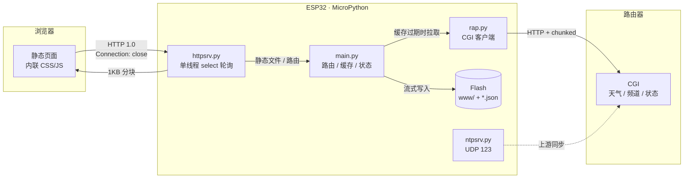

# ESP32 Terminal Server

基于 ESP32 + MicroPython 的无头终端服务器。运行单线程 HTTP 服务，向局域网提供页面与 API，
数据来自路由器上的 CGI 接口。


---

## 功能

| 页面 | 路径 | 内容 |
|---|---|---|
| 首页 | `/` | 设备状态、今日农历、天气实况、功能入口 |
| 天气 | `/weather.html` | 实况、24 小时、7 天预报、空气质量、生活指数 |
| 行情 | `/market.html` | 三大指数、汇率、自选股（存于板上） |
| 电台 | `/radio.html` | 67 个电台 / 9 个分类，支持搜索与折叠 |
| 本机 | `/info.html` | 固件、板型、CPU、MAC、堆、Flash、文件清单 |
| NTP | `/ntp.html` | 板载 NTP 服务端状态、上游同步、时区设置、农历 |
| IPTV | `/iptv.html` | 频道库浏览与网页播放 |

各页面通过顶栏互相跳转，共用 `web/theme.css` 样式系统，跟随系统深浅色。
页面为单文件形式，CSS/JS 内联，配合 gzip 预压缩。

---

## 硬件与依赖

| 项 | 要求 |
|---|---|
| 主控 | ESP32（4MB flash 起） |
| 固件 | MicroPython v1.26.1 `ESP32_GENERIC`，[下载](https://micropython.org/download/esp32/) |
| 串口 | CH9102 / CP2102 |
| 数据源 | 可运行 CGI 的路由器，见 [docs/CONFIG.md](docs/CONFIG.md) |

不需要 SD 卡、PSRAM 或外设。

---

## 架构



启动流程、请求生命周期、构建流水线见 [docs/ARCHITECTURE.md](docs/ARCHITECTURE.md)。

---

## 快速开始

### 1. 烧写固件

```bash
# 进下载模式：按住 BOOT → 点一下 EN → 松开 BOOT

pip install esptool
esptool.py --chip esp32 --port COM3 erase_flash
esptool.py --chip esp32 --port COM3 --baud 460800 write_flash -z 0x1000 ESP32_GENERIC-20250911-v1.26.1.bin
```

注意保留 `0xF000` 处的射频校准数据，详见 [docs/DEPLOY.md](docs/DEPLOY.md)。

### 2. 配置

```bash
cp esp32/config.example.json esp32/config.json
# 编辑 wifi.ssid / wifi.password / router.host
```

`config.json` 已被 `.gitignore` 排除。字段说明见 [docs/CONFIG.md](docs/CONFIG.md)。

### 3. 部署

```bash
pip install mpremote
python esp32/scripts/build.py
python esp32/scripts/up_batch.py esp32/main.py esp32/www/index.html ...
python esp32/scripts/flash.py --no-upload
```

可选：`python esp32/scripts/mpy.py` 将 6 个模块预编译为 `.mpy`，启动时间缩短约 1.6 秒。

完整步骤见 [docs/DEPLOY.md](docs/DEPLOY.md)。

---

## API

| 方法 | 路径 | 说明 |
|---|---|---|
| GET | `/api/health` | IP、RSSI、运行时长、剩余堆、路由器可达性 |
| GET | `/api/home` | 健康状态、服务状态、今日历法 |
| GET | `/api/info` | 固件、板型、CPU、MAC、堆、Flash、文件清单 |
| GET | `/api/weather` | 天气聚合数据 |
| GET | `/api/channels` | 频道库 |
| GET | `/api/services` | rtp2httpd / udpxy 运行状态 |
| GET | `/api/calendar` | 农历、节气、节日 |
| GET | `/api/quote` | 指数与汇率，10 分钟 TTL，`?force=1` 强制刷新 |
| GET | `/api/watch` | 自选股行情 |
| POST | `/api/watch` | `{"op":"add"/"del","code":"sh600519"}`，上限 20 支 |
| GET | `/api/ntp` | NTP 状态、上游、时区 |
| POST | `/api/ntp` | `sync` / `srv` / `upstream` / `interval` / `tz` |
| GET | `/api/config` | 读取配置（密码打码） |
| POST | `/api/config` | 保存配置并重启 |

---

## 目录结构

```
.
├── esp32/
│   ├── boot.py            上电：连接 WiFi / 启动配网热点
│   ├── main.py            路由、缓存、状态、API
│   ├── httpsrv.py         单线程非阻塞 HTTP 服务
│   ├── rap.py             路由器 CGI 客户端
│   ├── netmgr.py          WiFi 管理
│   ├── ntpsrv.py          板载 NTP 服务端（UDP 123）
│   ├── ntpsync.py         NTP 客户端
│   ├── cncal.py           农历 / 节气 / 节日
│   ├── config.example.json 配置模板
│   ├── web/               页面源码
│   ├── www/               构建产物（部署此目录）
│   └── scripts/           构建、上传、刷机、预编译
└── docs/
    ├── ARCHITECTURE.md
    ├── CONFIG.md
    └── DEPLOY.md
```

`www/` 由 `web/` 经 `scripts/build.py` 生成。修改页面应改 `web/` 下的源文件。

---

## 设计约束

| 约束 | 取值 | 原因 |
|---|---|---|
| 每请求 GC | `gc.collect()` | 临时对象累积会导致堆不足，`accept()` 失败 |
| listen backlog | 3 | TCP PCB 在握手时分配，池约 10 个 |
| 连接关闭方式 | 服务端等待客户端先关 | MicroPython 无 `SO_LINGER`，主动关闭会进入 TIME_WAIT 60 秒 |
| select 超时 | 30ms | 零超时会让 lwIP 任务得不到调度 |
| 单次分配上限 | 8KB | GC 不压缩内存，大块分配易失败 |
| 落盘方式 | 写 `.tmp` 后 rename | 避免并发读取到不完整文件 |

---

## 限制

- 单线程：慢请求会阻塞后续请求；联网接口均有 TTL 缓存，无后台轮询
- WiFi 密码以明文存于 flash
- 不支持 HTTPS
- 电台直链由第三方提供，可能失效
- IPTV 音视频由浏览器直连，不经过 ESP32
- `.mpy` 与解释器版本绑定（当前 `.mpy v6.3`），升级固件后需重新编译

---

## 脚本

| 脚本 | 用途 |
|---|---|
| `scripts/build.py` | 页面构建：内联 CSS/JS、生成 gzip（单页：`build.py weather`） |
| `scripts/up_batch.py` | 分批上传到设备，每批 4 个文件 |
| `scripts/flash.py` | 复位设备、捕获启动日志、请求 `/api/health` 自检 |
| `scripts/mpy.py` | 模块预编译为 `.mpy`（`--revert` 回退 .py） |
| `scripts/gen_calendar_data.py` | 重建农历年度数据表 |

串口与设备地址通过环境变量指定：

```bash
export ESP32_PORT=COM3
export ESP32_HOST=192.168.1.50
```

---

## License

MIT
