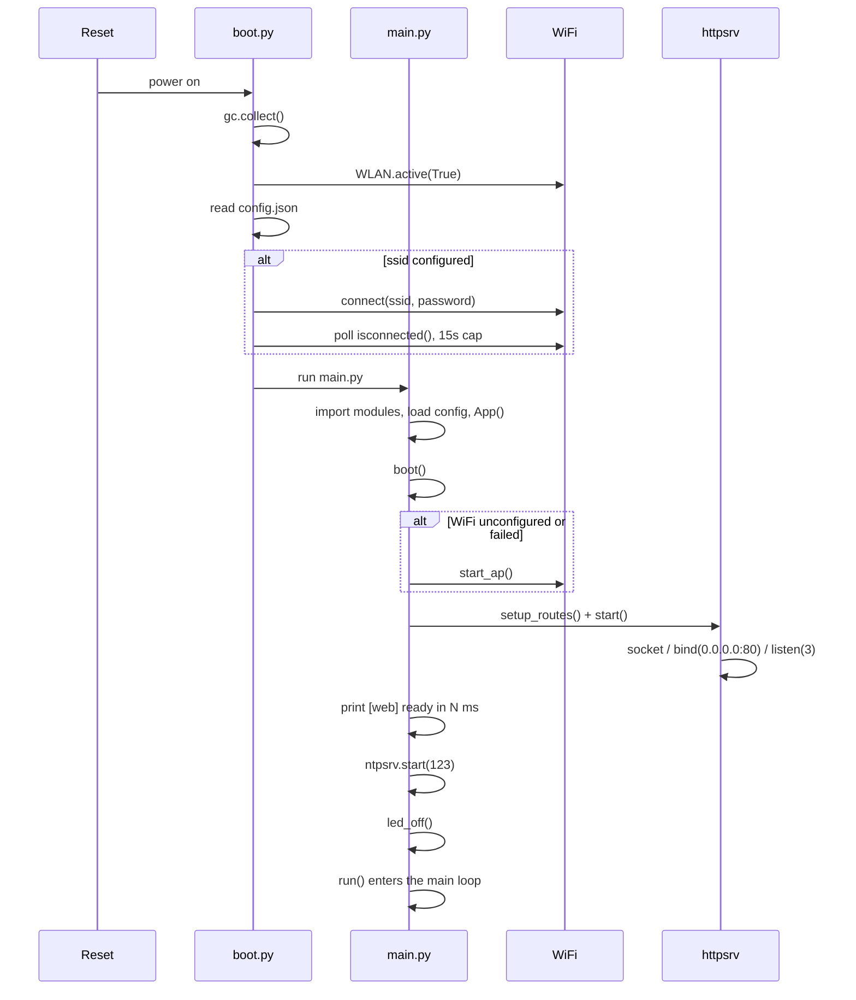
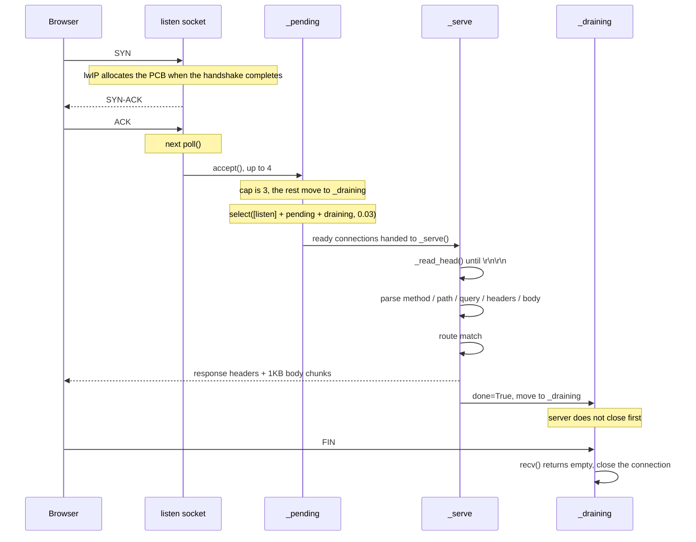
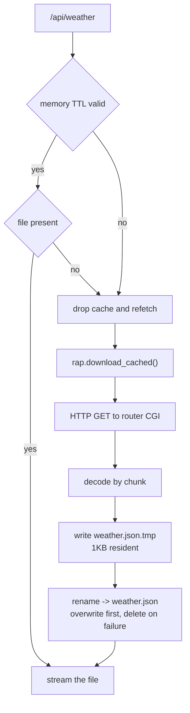
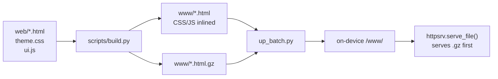
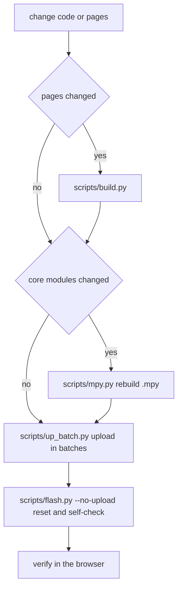

# Architecture and flow

**English** · [简体中文](ARCHITECTURE.md)

The system runs single-threaded with about 10 TCP PCBs available. The ESP32 build has about
70KB of heap in internal SRAM; the S3 build keeps its Python heap in 8MB PSRAM and leaves
internal SRAM to WiFi and lwIP.

`esp32/` and `esp32-s3/` are two board-level copies of the same code. Module boundaries and
flow are identical; differences are confined to `boot.py` (WiFi power saving), `main.py`
(LED driver, frequency management) and memory layout.

---

## 1. Components

| Module | Responsibility |
|---|---|
| `boot.py` | Power-on init: join WiFi, wait for DHCP |
| `main.py` | Routing, cache, state machine, all `/api/*` |
| `httpsrv.py` | Single-threaded non-blocking HTTP server; static files in chunks, uploads use a streaming body |
| `rap.py` | Router CGI client (chunked decoding, streaming to disk, TTL cache) |
| `netmgr.py` | WiFi management (STA / AP switching, reconnect) |
| `ntpsrv.py` | On-board NTP server (UDP 123) |
| `ntpsync.py` | NTP client, writes the RTC after sync |
| `cncal.py` | Lunar date / solar terms / festivals, local lookup tables |

The device never reaches the public internet; all external data is relayed by shell CGI on
the router. Router-side components live in `mirouter/`: 13 CGI (weather, quotes, fuel
prices, almanac, channels, system status, news, quakes), udpxy and rtp2httpd, and the entry
injection for the stock admin page. The inventory and deployment steps are in
[mirouter/README.md](../mirouter/README.md). The device connects directly to uhttpd on port
8088 and does not go through nginx.

---

## 2. Boot sequence



WiFi initialization lives in `boot.py`: the driver allocates roughly 12KB of static
buffers, and heap fragmentation after module imports would disrupt that allocation.

### Main loop

```
loop:
    web.poll()                    HTTP handling
    idle_power(now)               idle scaling: full speed on traffic, down when quiet (S3 only)
    led_heartbeat()               LED heartbeat (non-blocking)
    ntpsrv.serve() x 3            on-board NTP server
    wx_force -> poll_weather()    manual weather refresh, 20s read timeout
    channels_due -> refresh_channels()
    hist_due -> refresh_weather_history()
    clients_due -> poll_clients()
    svc_due -> poll_services()
    news_tick -> news_due         set catch-up flag hourly (S3 only)
    news_due -> refresh_news()    page back until caught up (S3 only)
    quake_due / quakeg_due / usgs_due -> refresh_* (S3 only)
    check WiFi state every 30s
    NTP sync (when due; calls web.poll(1) to yield)
    lunar table warm-up (once, when due)
    restart 800ms after a config save (reboot_at due -> machine.reset())
    sleep_ms(30)
```

The request path raises a refresh flag when it finds an expired cache; the next loop
iteration consumes it. Apart from the hourly news catch-up fetch, the loop never fetches on
its own: data is pulled only when a request arrives and the cache has expired.

### Idle frequency scaling

CPU frequency drops during idle periods to cut power draw and chip heat.

- After `power.idle_after_s` seconds without requests -> `machine.freq(idle_mhz)` (80MHz by default)
- Back to `max_mhz` when a connection is `accept`ed. Detection uses the `httpsrv.accepted`
  counter and accept timestamps within 2 seconds in `httpsrv._pending`
- After switching, an allocation check runs against PSRAM; unsupported boards disable the
  feature and log it
- 80MHz is the floor: WiFi needs an 80MHz APB clock and Octal PSRAM timing is configured for it
- Full speed is taken from config (`power.max_mhz`), never from `machine.freq()`: clock
  configuration does not survive a soft reset

---

## 3. Request lifecycle

`httpsrv.poll()` runs every 30ms and only touches connections that are ready.



### Connection rules

**listen backlog = 3**

TCP PCBs are allocated when the three-way handshake completes. With a large backlog, idle
pre-connections occupy the ~10 available PCBs and real requests get reset. At 3, excess SYNs
are retransmitted by the client.

**The server never closes first**

MicroPython has no `SO_LINGER`; an active `close()` leaves the PCB in TIME_WAIT for 60
seconds. After the response is sent the connection moves to `_draining` and waits for the
client. A passive close skips TIME_WAIT and the PCB is reusable immediately. A connection is
closed forcibly after 8 seconds or when more than 10 are queued.

**select timeout = 30ms**

Polling with a zero timeout starves the lwIP task and causes packet loss.

### Per-request collection

`_serve()` calls `gc.collect()` when it returns (about 3ms). Temporary objects must be
reclaimed promptly, otherwise the shrinking free heap makes both `accept()` and memory
allocation fail.

### Reentrancy guard

When a request has to wait for a router CGI, `rap` calls back into `poll()` to yield.
`_in_poll` caps the nesting depth at 2. A connection is removed from `_pending` before it is
served, so an inner `poll()` cannot close it early and break the outer write.

### Streaming request body

An ordinary route reads the whole body (the length given by `Content-Length`) into `bytes`
before handing it to the handler, which is fine for JSON. Uploads reach 289KB per file and
1.2MB per package, which would exhaust the heap, so those routes are registered with
`route_stream()`: `req.body` stays empty and the handler reads from `req.stream` in chunks.

| Aspect | Ordinary route | Streaming route |
|---|---|---|
| Body | `req.body` read up front | `req.stream.read(n)` on demand; only one recv buffer alive at a time |
| Timeout | the 1.0s set on accept | relaxed to 20s while the handler runs, so a slow upload is not mistaken for a pre-connected socket |
| Leftover body | none | discarded by `drain()` before the response, otherwise the client sees a RST |

The handler owns short-read detection: an empty `read()` means the peer hung up, and any
temporary file it wrote must be removed.

---

## 4. Data collection and caching



Large responses (weather about 30KB, channel library about 18KB) are never read into memory
as a whole; they are written to disk as they arrive. Any path that would allocate more than
8KB in one go must stream: GC does not compact memory, so large contiguous allocations fail
easily.

Cache lookup is based on file state, with a `stat` before every hit. Persisting always uses
"write a temp file, then rename" so concurrent readers never see a partial file.

A manual weather refresh takes two steps: `/api/weather?force=1` clears the router CGI cache
and the on-device memory cache and returns `refreshing` immediately; the main loop fetches
with a 20-second read timeout and the page re-renders once the data timestamp changes. The
fetch never occupies the HTTP request path.

News catch-up works page by page: `/cgi-bin/news?a=list` returns the newest page, then the
timestamp of its oldest item becomes `last_time` for the next page, walking backwards until
the previous collection point is covered or `news_pages` is reached. Each page is
deduplicated by `id` and appended to the day's CSV, so memory use is independent of page
count. After a restart the collection point is recovered from the last few days of CSV.

Page reads open a "newest first" window: day files are appended in ascending time order, and
when a read spans days the earlier day is concatenated in front of the later one; each file
is trimmed to the limit once read, so the API always returns the most recent slice rather
than the oldest. Reads `seek` backwards in 4KB blocks from the end of the file and parse
only the rows they need; walking a few hundred rows in order takes over two seconds and
stalls the single-threaded loop. `?limit=` sets the row count (default cap 120) and
`?before=<ctime>` returns the slice before that instant, which is how the page pages
backwards (another slice is fetched automatically within 240px of the bottom, and also when
the first screen is not full). Pull-to-refresh and the 5-minute timer only read the on-device
cache; `?force=1` triggers a fetch.

Idle periods are persisted the same way: when the CPU returns to full speed the interval is
appended to `sleep-YYYYMMDD.csv` as `key, end, start, seconds, MHz`. The in-memory `pm.log`
keeps only the 24 intervals of the current boot and is lost on restart, so the info page reads
the day files for its history and 7-day totals; `/api/sleep` reuses the same tail read and
`?before=` paging as the news and quake endpoints.

Fuel prices and the almanac share the same proxy pattern: the router CGI holds the upstream
credentials and caches for 24 hours, while the device caches only the parsed, trimmed
structures (prices keep value and change, the almanac keeps only the fields the page uses).
Both live in memory only; after a restart the router cache answers without another upstream
call.

The 7-day stats at the top of the page are aggregated on-device by `_csv_stats()`, grouped
by event time rather than file date (a single upstream response of 30 items can span several
days, and grouping by file would pile them all on the fetch date). The time is the first 10
characters of column 3 and rows outside the 7-day window are dropped. Magnitude is column 2;
the call returns daily counts plus cumulative M3 / M4 / M5 / M6 totals, and the page
subtracts adjacent buckets to get exclusive ranges, leaving anything below M3 out of the bar
height. Stats travel with the list response, so the page needs no second request.

USGS is a plain-text CSV source (`time,latitude,longitude,depth,mag,...,id,...,place`).
Parsed into the same 7 columns as the other quake sources and persisted per day, so the page
only has to switch the source prefix. Upstream times are UTC and are converted to local time
using `ntp.tz` before persisting.

Day files are named by local date, and the system year is validated before both fetching and
pruning. After a power cycle, `localtime` sits in the year 2000 until NTP completes: writing
then would create files with the wrong date, and the pruning logic would delete real history
based on the wrong retention set. When the clock is untrusted the fetch returns immediately
and keeps the pending flag for the next round.

---

## 5. Build pipeline

Page sources and deployable output are separate: edit `web/`, build into `www/`, deploy
`www/`.



`serve_file()` looks for a matching `.gz` file and sends the compressed version directly when
the client accepts gzip.

---

## 6. Deployment flow



A single `mpremote` transfer times out beyond about 8 files, so `up_batch.py` uploads 4 at a
time. A `mpremote` connection interrupts the running program, so reset after the transfer.

---

## 7. Resource budget

| Item | ESP32 build | S3 build |
|---|---|---|
| Idle heap after boot | 60~70KB | about 8MB (heap in PSRAM) |
| Largest contiguous internal RAM block | 20~30KB | about 128KB; below 16KB connections establish but return no data |
| Single large allocation cap | 8KB | 8KB (GC does not compact, same rule) |
| TCP PCB pool | about 10 | about 10 |
| select timeout | 30ms | 30ms |
| GC cost per request | about 3ms | about 0.2ms |
| Resident memory for large responses | 1KB | 1KB |
| Reset to service ready | 8~12s | 0.04~0.1s (reported as `ready_ms`) |

Diagnostic order: `gc.mem_free()` -> internal RAM blocks (S3) -> `select` / `accept` errors ->
application logic.

---

## 8. Extension points

### New API

1. Add `def h_xxx(self, req):` in `main.py`, returning `httpsrv.json_resp(...)`
2. Register it in `setup_routes()` with `w.route("GET", "/api/xxx", self.h_xxx)`
3. Operations taking longer than a second need a TTL cache

### New page

1. Start from `web/weather.html` and keep `<link rel="stylesheet" href="/theme.css">` and
   `<script src="/ui.js"></script>` (`build.py` inlines based on these)
2. `scripts/build.py` builds every HTML file under `web/` automatically
3. Add `w.serve_file("/xxx.html", "www/xxx.html")` to `setup_routes()`
4. Add a tab to the `PAGES` array in `web/ui.js`
5. Add an entry to `TILES` in `web/index.html`

### New router CGI

1. Add a shell script under `mirouter/cgi/`: LF line endings, cache in `/tmp`, single-flight
   via an atomic `mkdir` lock, upstream signatures via `openssl dgst` (the router has no `sha1sum`)
2. Upload with `python mirouter/tools/deploy.py cgi`; credentials come from deploy arguments
   and are never committed
3. Add the fetch path constant (`P_XXX`), a `refresh_xxx()` and a due flag in `main.py`, and
   consume the flag in the main loop
4. Add a row to the CGI table in `mirouter/README.md` and to the API table in `README.md`

### New config field

1. Add a default to `DEFAULT_CFG` in `main.py`
2. Add the same key to `config.example.json`
3. Document it in `docs/CONFIG.md`
