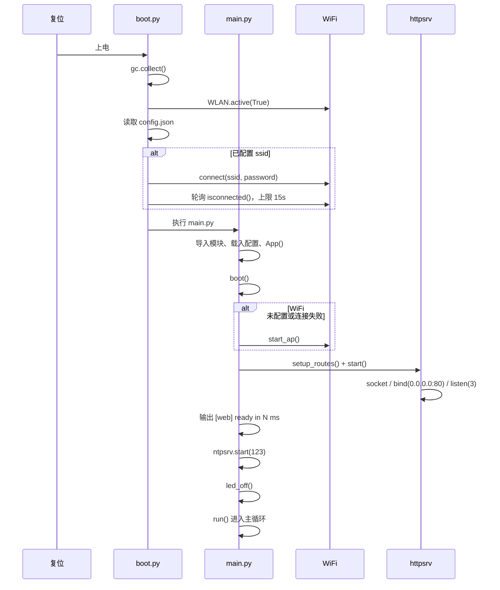
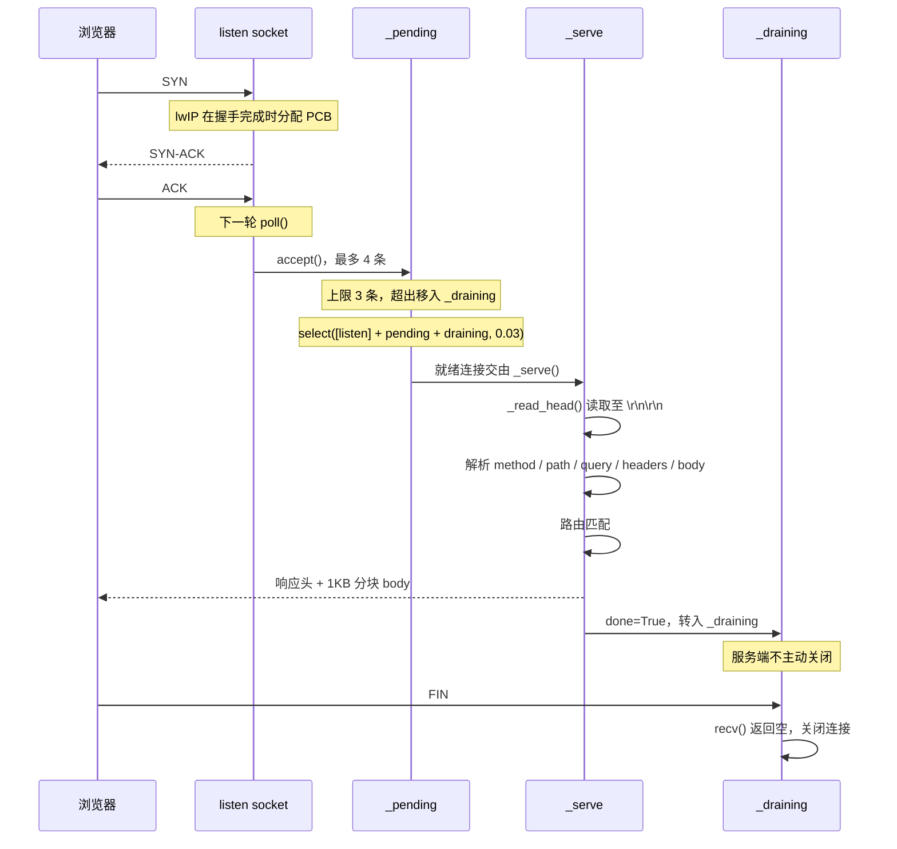
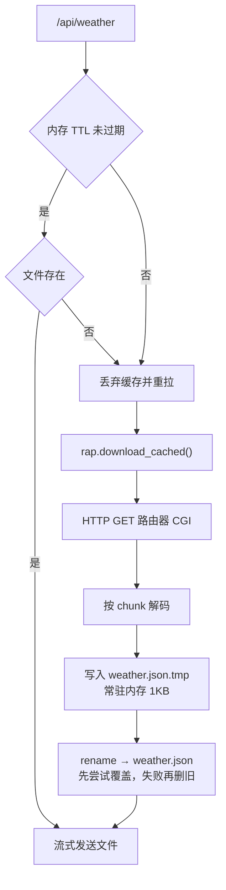
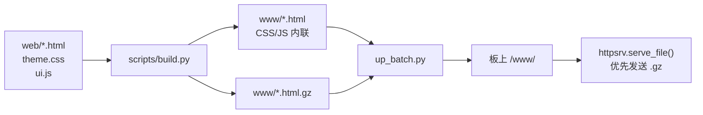
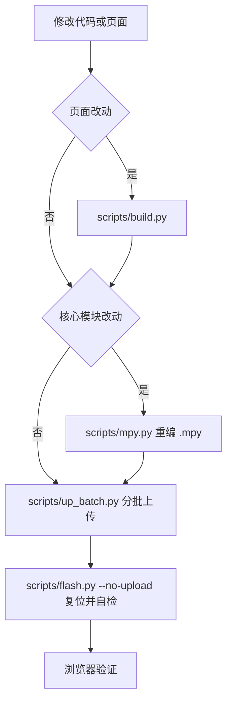

# 架构与流程

系统运行于单线程，可用 TCP PCB 约 10 个，堆空间约 70KB。以下流程均围绕该约束设计。

---

## 一、组件

| 模块 | 职责 |
|---|---|
| `boot.py` | 上电初始化：连接 WiFi、等待 DHCP |
| `main.py` | 路由、缓存、状态机、全部 `/api/*` |
| `httpsrv.py` | 单线程非阻塞 HTTP 服务 |
| `rap.py` | 路由器 CGI 客户端（chunked 解码、流式落盘、TTL 缓存） |
| `netmgr.py` | WiFi 管理（STA / AP 切换、断线重连） |
| `ntpsrv.py` | 板载 NTP 服务端（UDP 123） |
| `ntpsync.py` | NTP 客户端，同步后写入 RTC |
| `cncal.py` | 农历 / 节气 / 节日，本地查表 |

---

## 二、启动流程



WiFi 初始化位于 `boot.py`：驱动需一次申请约 12KB 静态缓冲区，在 `main.py` 导入模块后
堆空间已碎片化，容易初始化失败或长时间无法关联。

### 主循环

```
loop:
    web.poll()              HTTP 处理
    led_heartbeat()         LED 心跳（非阻塞）
    ntpsrv.serve() × 3      板载 NTP 服务端
    channels_due → refresh  缓存到期补刷
    svc_due → poll          服务状态补刷
    每 30s 检查 WiFi 状态
    NTP 同步（到点触发，内部调用 web.poll(1) 让出）
    农历年度表预热（到点触发）
    sleep_ms(30)
```

主循环内无周期性取数。数据在请求到达且缓存过期时才拉取。

---

## 三、请求生命周期

`httpsrv.poll()` 每 30ms 执行一次，仅处理已就绪的连接。



### 连接管理规则

**listen backlog = 3**

TCP PCB 在三次握手完成时分配。backlog 过大时，未发送请求的预连接会占满约 10 个 PCB，
导致真实请求被重置。设为 3 后，多余 SYN 由客户端重传。

**服务端不主动关闭连接**

MicroPython 无 `SO_LINGER`，主动 `close()` 会使 PCB 停留在 TIME_WAIT 60 秒。
响应发送完成后连接转入 `_draining`，等待客户端关闭；被动关闭不进入 TIME_WAIT，PCB 可立即复用。
超时 8 秒或积压超过 10 条时强制关闭。

**select 超时 = 30ms**

零超时轮询会导致 lwIP 任务得不到调度，出现丢包。

### 每请求回收

`_serve()` 结束时执行 `gc.collect()`（约 3ms）。单次请求产生的临时对象不会被及时回收，
累计约十次后空闲堆降至 20KB 以下，`accept()` 与内存分配开始失败。

### 重入保护

请求处理中若需等待路由器 CGI，`rap` 会回调 `poll()` 让出。`_in_poll` 计数限制重入深度为 2。
处理连接前需将其从 `_pending` 移出，避免内层 `poll()` 提前关闭连接导致外层发送失败。

---

## 四、数据采集与缓存



大响应（天气约 30KB、频道库约 18KB）不整包读入内存，改为边接收边写文件。
单次分配超过 8KB 的路径均需流式处理：GC 不压缩内存，大块连续分配容易失败。

缓存判定以文件状态为准，命中前执行 `stat`。落盘采用「写临时文件 → rename」，
避免并发读取到不完整内容。

---

## 五、构建流水线

页面源码与部署产物分离：修改 `web/`，构建输出 `www/`，部署 `www/`。



`serve_file()` 检测同名 `.gz` 文件，客户端支持 gzip 时直接发送压缩版本。

---

## 六、部署流程



`mpremote` 单次传输超过约 8 个文件会超时，`up_batch.py` 每批上传 4 个文件。
`mpremote` 连接会中断运行中的程序，传输完成后需复位。

---

## 七、资源预算

| 项 | 数值 |
|---|---|
| 就绪后空闲堆 | 60~70KB |
| 单次大内存分配上限 | 8KB |
| TCP PCB 池 | 约 10 个 |
| select 超时 | 30ms |
| 每请求 GC 耗时 | 约 3ms |
| 大响应常驻内存 | 1KB |

排查顺序：`gc.mem_free()` → `select` / `accept` 错误 → 业务逻辑。

---

## 八、扩展

### 新增 API

1. 在 `main.py` 添加 `def h_xxx(self, req):`，返回 `httpsrv.json_resp(...)`
2. 在 `setup_routes()` 注册 `w.route("GET", "/api/xxx", self.h_xxx)`
3. 耗时超过 1 秒的操作需配合 TTL 缓存

### 新增页面

1. 基于 `web/weather.html` 创建，保留 `<link rel="stylesheet" href="/theme.css">`
   与 `<script src="/ui.js"></script>`（`build.py` 依此内联）
2. `scripts/build.py` 自动构建 `web/` 下全部 HTML
3. `setup_routes()` 添加 `w.serve_file("/xxx.html", "www/xxx.html")`
4. `web/ui.js` 的 `PAGES` 数组添加页签
5. `web/index.html` 的 `TILES` 添加入口

### 新增配置项

1. 在 `main.py` 的 `DEFAULT_CFG` 中添加默认值
2. 在 `config.example.json` 中添加同名键
3. 在 `docs/CONFIG.md` 中补充说明
